# Recover, Discover, Plan: Learning Skills and Concepts from Robot Failures

**ReSYNC · CoRL 2026**

[Bowen Li](https://jaraxxus-me.github.io/), [Mayank Mishra](https://mmayank74567.github.io/), [Y. Isabel Liu](https://yil42.github.io/), [Stone Tao](https://stonet2000.github.io/), [Nishanth Kumar](https://nishanthjkumar.com/), Alexander Gray, Ruwan Wickramarachchi, [Jonathan Francis](https://jonfranc.com/), [Sebastian Scherer](http://theairlab.org/team/sebastian/), and [Tom Silver](https://tomsilver.github.io/).

[Paper](https://arxiv.org/abs/2606.18328) · [Project website](https://jaraxxus-me.github.io/ReSYNC/) · [inference assets](https://drive.google.com/drive/folders/1w1gB9M4SrqF-3-vQY6t6R-TdOFs4ycID)

## Abstract

Intelligent robots should not only recover from failures, but also acquire the abstract knowledge needed to avoid them in the future. While reinforcement learning (RL) can learn reactive recovery behaviors, training a separate policy for every distinct failure mode is highly inefficient. We introduce Recovery-Driven Synthesis of Relational Concepts (ReSYNC), the first approach that progressively discovers and refines state abstractions (relational predicates) from failure-recovery experience to support abstract planning. Unlike purely reactive methods, ReSYNC jointly learns skills and concepts through an incremental dual-learning process. In the skill-learning phase, the robot uses RL to learn to recover from failures seen in training tasks. In the concept-learning phase, the robot discovers new relational predicates and refines its abstract planning model to explain and generalize the learned recovery behaviors. This interaction enables ReSYNC to convert local recoveries seen during training into global failure avoidance at test time. Across four simulated domains, we show that ReSYNC's ability to continually expand and refine its abstraction library allows it to solve long-horizon, previously unseen problems, outperforming strong baselines by over 50%. Additionally, we demonstrate sim-to-real transfer of ReSYNC, where it performs real-world non-prehensile manipulation skills and generalizes to unseen scenarios through abstract planning. Overall, ReSYNC represents a significant step toward robots that autonomously acquire abstractions for scalable, failure-aware planning in the physical world.

## Recovery Gallery

Six domains, two representative scenarios each. **Train** shows inference in a recovery-training setup; **Test** shows the skill reused at a different target or in a longer composition. These are selected successful demonstrations, not aggregate evaluation results. GIFs loop automatically; click a preview for its larger MP4. IsaacLab recovery skills play at original speed; only the surrounding planned motions are accelerated. Cluttered Room shows complete episodes with accelerated planned motions and a goal-centered close-up during the slow-motion RL push; the other previews use accelerated playback.

| Domain name | Recovery skill(s) description | Train scenario(s) | Test scenario(s) |
| --- | --- | --- | --- |
| **Icy Transport** | <b>IcyDrive</b> and <b>MuddyDrive</b> cross slippery or high-friction regions. The previews show IcyDrive. | Ice on the way to an object (`1_g1`).<br><a href="docs/static/videos/recovery-icy-train.mp4">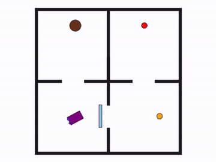</a> | Ice on the way to the delivery goal (`1_b`).<br><a href="docs/static/videos/recovery-icy-test.mp4">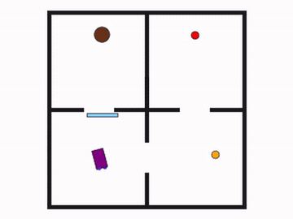</a> |
| **Blocked Stacking** | <b>Punch</b>, <b>Wiggle</b>, and <b>Fiddle</b> dislodge different obstructions. The previews show Punch. | Clear the block to be grasped (`1_g`).<br><a href="docs/static/videos/recovery-blocked-train.mp4">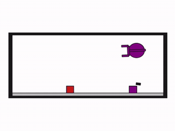</a> | Clear the stacking target (`1_b`).<br><a href="docs/static/videos/recovery-blocked-test.mp4">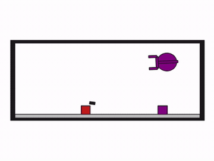</a> |
| **Cluttered Drawer** | <b>Pull</b> opens the drawer; <b>Wiggle</b> frees a cluttered grasp. The previews show Pull. | Open the drawer to retrieve the hammer (`1_g`).<br><a href="docs/static/videos/recovery-drawer-train.mp4">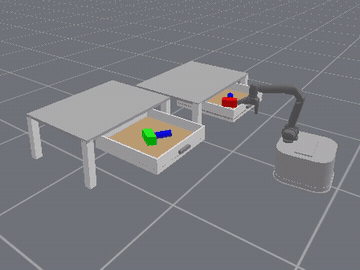</a> | Open the drawer to reach the placement target (`1_b`).<br><a href="docs/static/videos/recovery-drawer-test.mp4">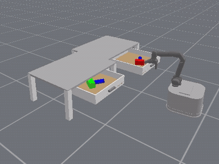</a> |
| **Cluttered Room** | <b>Push</b> moves a can out of an occupied goal before object placement. | Clear the box’s placement goal (`1_g`).<br><a href="docs/static/videos/recovery-room-train.mp4">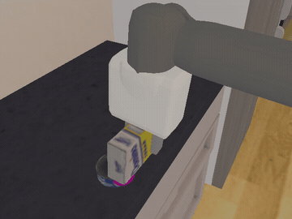</a> | Reuse Push at the bowl’s placement goal (`1_b`).<br><a href="docs/static/videos/recovery-room-test.mp4">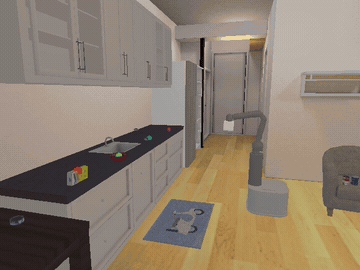</a> |
| **Flipped Stacking** | <b>Flip</b> turns an inverted block upright before pick-and-place. | Flip one block, then stack two (`top`).<br><a href="docs/static/videos/recovery-flipped-train.mp4">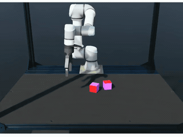</a> | Flip two blocks, then build a four-block tower (`top + mid1`).<br><a href="docs/static/videos/recovery-flipped-test.mp4">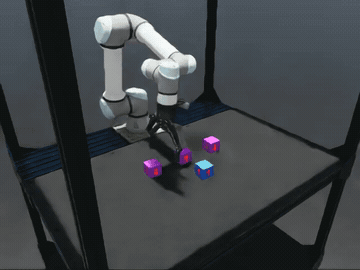</a> |
| **Cornered Stacking** | A learned <b>corner recovery</b> repositions a block near the enclosure walls for stacking. | Recover the block to be picked up (`1_g`).<br><a href="docs/static/videos/recovery-corner-train.mp4">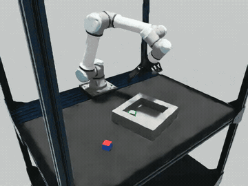</a> | Recover the block used as the stacking support (`1_b`).<br><a href="docs/static/videos/recovery-corner-test.mp4">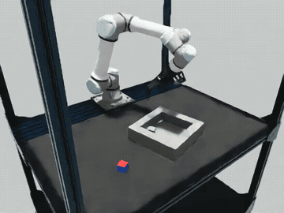</a> |

The first four rows illustrate the original simulated benchmarks; the IsaacLab rows are inference demos. [Scenario and media provenance](docs/static/images/recovery/manifest.json) records the source rollouts and preview edits.

## Installation

Use Linux with an NVIDIA GPU, working NVIDIA graphics/Vulkan drivers, and Python 3.11. Inference was tested on an RTX 3090 Ti with NVIDIA driver 580.173.02. Cluttered Drawer and Cluttered Room use GPU simulation.

Install [uv](https://docs.astral.sh/uv/getting-started/installation/), then run from this repository's root:

```bash
git clone https://github.com/Jaraxxus-Me/ReSYNC.git
cd ReSYNC
uv venv --python 3.11 .venv
source .venv/bin/activate
uv pip install -r release/requirements-linux.lock
uv pip install --no-deps -e . \
  -e third-party/prpl-mono/prpl-utils \
  -e third-party/prpl-mono/prbench \
  -e third-party/prpl-mono/relational-structs \
  -e third-party/prpl-mono/toms-geoms-2d
```

The lock file records the tested Linux environment, including PyTorch 2.11.0, NumPy 1.26.4, ManiSkill 3.0.0b21, SAPIEN 3.0.3, and Pymunk 7.2.0. Run all commands below in this environment, from the repository root.

## Asset preparation

The [asset folder](https://drive.google.com/drive/folders/1w1gB9M4SrqF-3-vQY6t6R-TdOFs4ycID) contains the policy checkpoints, predicate and terminal networks, effect vectors, variable bindings, symbolic operators, and supporting planner datasets. Downloads are split into parts of at most 90 MiB. The downloader reassembles each ZIP and verifies SHA-256 checksums for both archives and extracted files using [release/assets_manifest.json](release/assets_manifest.json).

For the two installation sanity checks:

```bash
python scripts/download_release_assets.py --domains simulation_assets blocked_stacking cluttered_drawer
```

To obtain the simulation assets and all four simulated-domain model bundles, including meshes and object models:

```bash
python scripts/download_release_assets.py
```

| Bundle | Contents | Compressed size |
| --- | --- | --- |
| Simulation assets | Robot, drawer, hammer, YCB objects, and other meshes | 90 MiB |
| Blocked Stacking | Punch, Wiggle, Fiddle policies; stage-1/2/3 predicates; planner data | 170 MiB |
| Cluttered Drawer | Pull and Wiggle policies; stage-1/2 predicates; planner data | 248 MiB |
| Icy Transport | IcyDrive and MuddyDrive policies; stage-1/2 predicates; planner data | 83 MiB |
| Cluttered Room (Rearrange) | Push policy, predicates, and planner data | 19 MiB |

The model bundles contain inference assets under `inference_assets/<environment>/`: policy checkpoints, predicate networks, symbolic operators, and supporting planner datasets. Configurations are in `config/inference/`.

Planner datasets remain necessary even for inference: the loader reconstructs candidate predicates and reads training plan skeletons before loading the saved operators.

The simulation-assets bundle includes the ManiSkill YCB objects and custom meshes. **Set `MS_ASSET_DIR` before importing ManiSkill**, including in every new shell:

```bash
export MS_ASSET_DIR="$PWD/src/skill_refactor/assets/maniskill_assets"
```

The robot, drawer, hammer, YCB, and other meshes are restored under `src/skill_refactor/assets/`, which is excluded from Git.

Cluttered Room additionally requires ReplicaCAD and ReplicaCADRearrange. Use the revisions recorded in [release/external_assets_manifest.json](release/external_assets_manifest.json), which specify the simulator datasets:

```bash
hf download haosulab/ReplicaCAD --repo-type dataset \
  --revision 88bdca74dd4ec1f8c994904f7985392fc3f2b4c4 \
  --local-dir "$MS_ASSET_DIR/data/scene_datasets/replica_cad_dataset"
hf download haosulab/ReplicaCADRearrange rearrange.zip --repo-type dataset \
  --revision c5921276ddece53607cd7dd55e7ed54385c9e49d \
  --local-dir .release-cache/room
echo "6ab9a0ceece6e0fe176ffc67a6aab1bad1efb7a4bf70808089e19673cd59b15b  .release-cache/room/rearrange.zip" | sha256sum --check &&
python -m zipfile -e .release-cache/room/rearrange.zip \
  "$MS_ASSET_DIR/data/scene_datasets/replica_cad_dataset"
```

These external datasets are additional to the Google Drive bundles.

## Installation sanity checks: learned skills and predicates

Run the following commands after installation and asset preparation:

```bash
python scripts/sanity_check.py --env blocked_stacking --episodes 5
python scripts/sanity_check.py --env cluttered_drawer --episodes 5
```

Each command loads the configured policy, neural predicates, and symbolic operators, then evaluates both configurations:

- **`1_g`**: the obstruction prevents grasping, as in the recovery training distribution.
- **`1_b`**: the obstruction is at the placement/stacking target, testing reuse of the learned recovery in a new composition.

The check uses `LifelongRefApproach` and the stage-1 inference configuration, without training. It uses a fixed episode-reset schedule, applies the configured action conversion and stopping conditions, and runs without video recording. It writes per-episode outcomes and executed operator sequences to `results/sanity_<environment>.json`, with detailed logs beside that file. It exits unsuccessfully if either configuration never succeeds or never executes its learned recovery (`Punch` or `Pull`). Individual failed episodes are expected with the learned policies.

For 50 episodes per configuration:

```bash
python scripts/sanity_check.py --env blocked_stacking --episodes 50
python scripts/sanity_check.py --env cluttered_drawer --episodes 50
```

The stage-1 rollout limits are 300 steps for Blocked Stacking and 900 for Cluttered Drawer.

## Reproduce the experiments

After downloading the models and simulation assets, use the main environment for Blocked Stacking, Drawer, and Room. Run 50 episodes for each configuration with:

```bash
for experiment in \
  blocked_stacking_stage1 blocked_stacking_stage2 blocked_stacking_stage3 \
  cluttered_drawer_stage1 cluttered_drawer_stage2
do
  python scripts/reproduce_release.py --experiment "$experiment" \
    --episodes 50 --threads 1 --output "results/reproduction/${experiment}.json"
done
```

Run each Cluttered Room scenario in its own process:

```bash
for scenario in 1_g 1_b
do
  python scripts/reproduce_release.py --experiment cluttered_room_stage1 \
    --cases "$scenario" --episodes 50 --threads 1 \
    --output "results/reproduction/cluttered_room_${scenario}.json"
done
```

The runner loads the inference assets without training and records per-episode outcomes, model hashes, and success rates. Blocked Stacking and Icy Transport use CPU inference; Drawer and Room require the GPU simulation setup above. Room also requires the additional ReplicaCAD downloads.

Icy Transport uses a separate environment pinned to PyTorch 2.9.1. The placement evaluation is sensitive to the PyTorch version: the clean installation below reproduces 37/50, while the main environment produces 36/50 with the same models and reset schedule.

```bash
uv venv --python 3.11 .venv-icy
uv pip install --python .venv-icy/bin/python -r release/requirements-icy-transport.lock
uv pip install --python .venv-icy/bin/python --no-deps -e . \
  -e third-party/prpl-mono/prpl-utils \
  -e third-party/prpl-mono/prbench \
  -e third-party/prpl-mono/relational-structs \
  -e third-party/prpl-mono/toms-geoms-2d
for experiment in icy_transport_stage1 icy_transport_stage2
do
  .venv-icy/bin/python scripts/reproduce_release.py --experiment "$experiment" \
    --episodes 50 --threads 1 --output "results/reproduction/${experiment}.json"
done
```

Observed success rates over 50 episodes per scenario. Icy Transport uses PyTorch 2.9.1.

| Environment | Stage | Scenario | Success rate |
| --- | --- | --- | --- |
| Blocked Stacking | 1 | `1_g` | 70% |
| Blocked Stacking | 1 | `1_b` | 78% |
| Blocked Stacking | 2 | `1_g_2_g` | 72% |
| Blocked Stacking | 2 | `1_g` | 70% |
| Blocked Stacking | 2 | `1_b` | 78% |
| Blocked Stacking | 2 | `1_g_2_b` | 76% |
| Blocked Stacking | 2 | `1_b_2_g` | 78% |
| Blocked Stacking | 2 | `1_b_2_b` | 68% |
| Blocked Stacking | 2 | `2_g` | 100% |
| Blocked Stacking | 2 | `2_b` | 100% |
| Blocked Stacking | 3 | `1_b_2_b_3_g` | 82% |
| Blocked Stacking | 3 | `1_g_2_g` | 72% |
| Blocked Stacking | 3 | `1_g` | 70% |
| Blocked Stacking | 3 | `1_b` | 78% |
| Blocked Stacking | 3 | `1_g_2_b` | 76% |
| Blocked Stacking | 3 | `1_b_2_g` | 78% |
| Blocked Stacking | 3 | `1_b_2_b` | 68% |
| Blocked Stacking | 3 | `2_g` | 100% |
| Blocked Stacking | 3 | `2_b` | 100% |
| Blocked Stacking | 3 | `1_g_2_g_3_b` | 74% |
| Blocked Stacking | 3 | `1_b_3_g` | 78% |
| Blocked Stacking | 3 | `1_g_3_b` | 68% |
| Blocked Stacking | 3 | `2_b_3_g` | 82% |
| Blocked Stacking | 3 | `2_g_3_b` | 80% |
| Blocked Stacking | 3 | `3_b` | 96% |
| Blocked Stacking | 3 | `3_g` | 96% |
| Icy Transport | 1 | `1_g1` | 88% |
| Icy Transport | 1 | `1_b` | 74% |
| Icy Transport | 1 | `1_g2` | 72% |
| Icy Transport | 2 | `1_g1` | 88% |
| Icy Transport | 2 | `1_b` | 74% |
| Icy Transport | 2 | `1_g2` | 72% |
| Icy Transport | 2 | `2_g1` | 100% |
| Icy Transport | 2 | `2_b` | 84% |
| Icy Transport | 2 | `2_g2` | 100% |
| Icy Transport | 2 | `1_g1_2_b` | 80% |
| Icy Transport | 2 | `1_b_2_g1` | 52% |
| Icy Transport | 2 | `1_b_2_g2` | 74% |
| Icy Transport | 2 | `1_g2_2_g1` | 72% |
| Icy Transport | 2 | `1_g2_2_b` | 60% |
| Icy Transport | 2 | `1_g1_2_g2` | 78% |
| Cluttered Drawer | 1 | `1_g` | 98% |
| Cluttered Drawer | 1 | `1_b` | 96% |
| Cluttered Drawer | 2 | `1_g_2_g` | 68% |
| Cluttered Drawer | 2 | `1_g` | 64% |
| Cluttered Drawer | 2 | `1_b` | 82% |
| Cluttered Drawer | 2 | `1_g_2_b` | 72% |
| Cluttered Drawer | 2 | `1_b_2_g` | 74% |
| Cluttered Drawer | 2 | `1_b_2_b` | 78% |
| Cluttered Room | 1 | `1_g` | 52% |
| Cluttered Room | 1 | `1_b` | 48% |

## IsaacLab Env Demos

The optional IsaacLab demos run pretrained skills with learned predicates and symbolic operators. They use a separate environment and asset bundle; the four-domain reproduction commands and dependency locks above are unchanged. These are qualitative inference/video demonstrations, not additions to the reported success-rate table.

Use Linux, an NVIDIA GPU with working Vulkan drivers, and Python 3.11. Download the additional assets from the same [release folder](https://drive.google.com/drive/folders/1w1gB9M4SrqF-3-vQY6t6R-TdOFs4ycID), then install the isolated runtime:

```bash
# Use the existing reproduction environment for the downloader.
.venv/bin/python scripts/download_isaac_assets.py
bash scripts/install_isaac_demo.sh
# After reviewing and accepting NVIDIA's Omniverse license:
export OMNI_KIT_ACCEPT_EULA=YES
```

The installer creates `.venv-isaac` with Isaac Sim 5.1.0, the bundled IsaacLab/UWLab source revisions, PyTorch 2.7.0+cu128, and Gymnasium 1.1.1. It installs without dependency resolution because the upstream packages declare conflicting Gymnasium requirements. It does not modify `.venv` or `.venv-icy`. NVIDIA's Omniverse license must be accepted on first launch; for headless execution after reviewing the license, set `OMNI_KIT_ACCEPT_EULA=YES`.

**Flipped Stacking:** four blocks by default, ordered `top → mid1 → mid2 → bottom`. Exactly two start inverted. Omit `--flipped` to sample a pair, or select any two distinct roles:

```bash
.venv-isaac/bin/python scripts/infer_isaac.py \
  --env flipped_stacking --headless --record-video \
  --output results/isaac_demos/flipped

.venv-isaac/bin/python scripts/infer_isaac.py \
  --env flipped_stacking --flipped top bottom --headless --record-video \
  --output results/isaac_demos/flipped_top_bottom
```

`--num-blocks 2` and `--num-blocks 3` are also supported. The learned plan uses `MoveToFlip`, the pretrained `Flip` policy, and scripted `Pick`/`Place` skills. As in the source demonstration, the runner applies explicit symbolic composition repairs, orders tower construction bottom-up, and advances on skill termination rather than checking learned symbolic effects.

**Cornered Stacking:** `block0` is the block associated with the corner/box recovery, and `block1` is the outside block. `1_g` stacks `block0` on `block1` (recovery on the grasped block); `1_b` stacks `block1` on `block0` (recovery on the support block):

```bash
for scenario in 1_g 1_b; do
  .venv-isaac/bin/python scripts/infer_isaac.py \
    --env corner_stacking --case "$scenario" --headless --record-video \
    --output "results/isaac_demos/corner_${scenario}"
done
```

The corner demo uses the saved neural predicates/operators and native RL recovery policy. It preserves the source hybrid execution: if the learned plan omits recovery, the runner explicitly prefixes it and records that intervention.

Both commands write an MP4 with the skill sequence, an `episodes.json` execution log, and a `provenance.json` containing runtime versions and model/source hashes. Use `--episodes`, `--seed`, and `--max-steps` to control a run; omit `--headless` for an interactive window. Failed episodes can occur. Logs distinguish skill completion from the physical stacking goal. Asset checksums and source revisions are in `release/isaac/`; verify downloaded assets with `python scripts/download_isaac_assets.py --verify-only`.

## Citation

If you find our inspiring or used our code, please cite us at:

```bibtex
@inproceedings{li2026recover,
  title={Recover, Discover, Plan: Learning Skills and Concepts from Robot Failures},
  author={Li, Bowen and Mishra, Mayank and Liu, Y. Isabel and Tao, Stone and Kumar, Nishanth and Gray, Alexander and Wickramarachchi, Ruwan and Francis, Jonathan and Scherer, Sebastian and Silver, Tom},
  booktitle={Proceedings of the Conference on Robot Learning (CoRL)},
  year={2026}
}
```

The source retains its upstream [MIT license](LICENSE) and dependency licenses.

## RoadMap

- [x] Installation and inference checks.
- [x] IsaacLab Flipped Stacking and Cornered Stacking demos with learned predicates, pretrained skills, and video recording.
- [ ] Test predicate learning in BlockedStacking stage 1.
